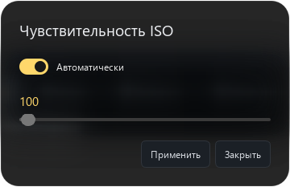
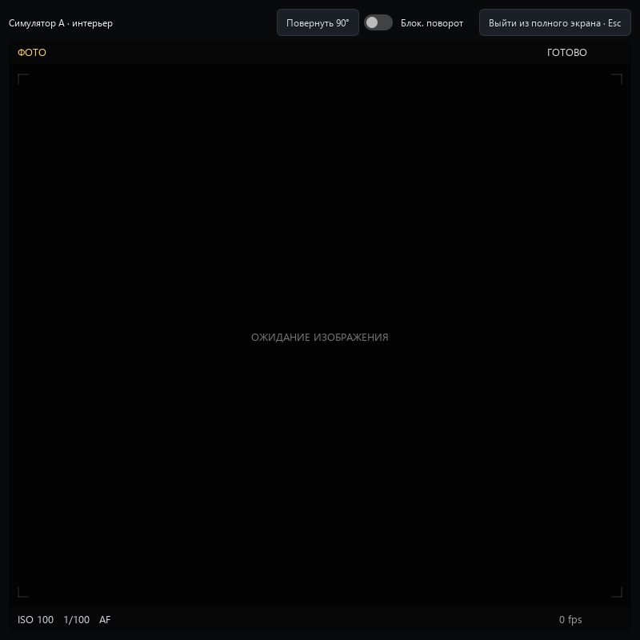

# Camera Deck Aurora

Android phone cameras controlled from a Windows desk. Version **0.7.0 is an experimental prerelease**, Android 9+ / Windows 10–11 x64. Camera options come from Camera2 and encoder capabilities, without a manufacturer allowlist or an artificial 4K/24 MP limit. Physical-phone and physical-USB validation remains necessary.

## Installation and first connection

Install `CameraDeck-Aurora-Android.apk` over Aurora and run `CameraDeck-Aurora-Windows.exe`. Do not uninstall Aurora: uninstalling removes its private recordings and trusted computers. Original Camera Deck and the earlier `.preview` remain separate applications; stop their camera before starting Aurora.

Connect both devices to the same Wi-Fi. On the phone press **Включить**, grant camera/microphone permissions, then open **Подключить**. On Windows choose the discovered phone, compare the entire SHA-256 fingerprint and enter its PIN. Manual local IP entry is available when broadcast discovery is blocked.

With **Доверять этому компьютеру** selected, subsequent discovery reconnects without another PIN. Windows encrypts the remembered credential using account-bound DPAPI; the phone stores only its hash. The saved fingerprint must match before the credential is sent. Changed certificates require fresh verification. Android **Ещё → Доверенные компьютеры** revokes individual access; **Отозвать доступ компьютеров** removes all remembered clients and active sessions. Windows **Устройства → Доверенные телефоны** forgets local credentials; when connected it also revokes that computer on the phone. Forgetting an offline phone removes only the local copy.

## Live monitoring

- Native Camera2/TextureView phone preview, with JPEG fallback for rejected output combinations.
- Windows first requests **H.264 over pinned TLS**. Camera and codec capabilities select the real preview size/rate. Balanced targets up to 1280×720/60 fps, Detail up to 1920×1080/60 fps; Eco targets 30 fps for AVC. Original recording resolution/FPS are independent.
- No B-frames are requested. The server keeps at most 16 access units / 4 MB. A slow viewer resumes at a fresh IDR containing SPS/PPS; small socket buffers and TCP_NODELAY reduce buffering. Backpressure lowers bitrate, which can recover toward 6 Mbps / 12 Mbps. A single decoded display frame replaces older frames; decoder runs outside the GUI thread. The HUD reports observed display FPS, not an advertised camera rate.
- Unsupported AVC combinations use authenticated multipart JPEG (up to 24 fps / 12 Eco). A rejected native preview can similarly fall back without interrupting original recording.
- Each camera opens independently fullscreen; Esc returns. The main window starts windowed. Menus manage devices, layout and updates.

This is not WebRTC, and zero delay, 60 fps on every phone, perfect audio/video sync, or physical Wi-Fi performance is not promised. Live PCM audio is separate and not lip-synchronized. Enabling face analysis also consumes CPU; disable it when maximum preview throughput matters.

## Framing, zoom and focus

**Кадр / зум** on Windows or **Ещё → Кадр, зум и лица** on Android offers the camera's actual zoom range, manual zoom, and smooth automatic zoom based on the largest detected face. Presets: **Общий**, **Средний**, **Портрет**, **Крупный**. When the face is lost, zoom stays unchanged; it never invents a target or changes lenses mid-recording.

The bundled ML Kit model detects faces and eye landmarks locally; frames are not uploaded to a recognition service. Eye circles appear only when the detector reports landmarks. The main face can direct the camera's AF metering region if supported. Tapping the viewfinder chooses an AF region and turns off automatic face-region selection. A green indicator means Camera2 reports passive-focused / focused-locked; face/eye detection itself does not prove sharpness or provide vendor-specific eye-AF.

The phone interface follows sensor orientation. Stream packets carry rotation so Windows displays portrait, landscape and upside-down orientations correctly. MP4 orientation is fixed when recording starts; rotating during recording updates the live view, not the orientation metadata of an already-open file.

## Capture and storage

Normal video sizes and FPS are discovered from Camera2 stream durations, AE ranges and H.264/HEVC encoder support. 4K60 is selectable when that combination is exposed and usable. Special high-speed and maximum-sensor modes are listed separately; special-session capture, HDR/Log and every vendor camera feature are not implemented.

JPEG, PNG, WebP and RAW DNG are capability-gated. PNG/WebP convert processed JPEG, while DNG uses actual RAW_SENSOR data. Large conversions can exceed phone memory. Photos are unavailable during video recording. Unsupported RAW/preview combinations report the failure and restore JPEG.

The phone shows free bytes and supports a persistent Android system-selected folder, including mounted USB providers. MP4 writes directly to a seekable destination descriptor. Photos stage privately, then export; failed export retains the original. Partial media is not presented as finished. Stop recording before changing the destination. Physical disks and unplugging require device tests.

## Automatic updates

**One manual upgrade from 0.6 Aurora is required to bootstrap this channel.** Subsequent Aurora releases contain `camera-deck-update.json`, signed by the dedicated Aurora RSA key. Both applications independently check public GitHub releases without user credentials, verify product/channel/version/signature and artifact hashes, then download. Existing original-app signing identities and public keys are unchanged.

Windows applies a downloaded update when closing an idle desk, retaining `.previous`; active or uncertain recording prevents automatic replacement. Android downloads and stages automatically; **Ещё → Установить обновление** opens the system installer. Android requires installation approval and permission to install from this source: silent installation is not claimed. Downloads do not stop recording. Android additionally checks the APK package, version and signing certificate. Automatic downloading can be disabled on either device. Windows can also transfer a verified APK to an older connected Aurora that supports this update channel.

The persistent Aurora APK identity lives under `%LOCALAPPDATA%/CameraDeck/aurora-preview-signing`. `scripts/sign_preview.py` signs only `.aurora`. `scripts/aurora_manifest.py --init` creates/loads a separate DPAPI-protected Aurora updater key and refuses to replace an existing public identity. To prepare releases, sign the APK, stage matching EXE/APK, then run `python scripts/aurora_manifest.py release/FOLDER`. Keep both private identities and their Windows account; do not commit them. Losing keys requires a new explicitly migrated channel.

## Power and security

Start camera service while the phone app is visible. Background/screen-off recording uses a foreground notification with Stop. No boot auto-start, permanent wake lock or battery exemption is requested. Hidden/minimized Windows monitors pause video while status polling continues. With no viewer, local demand, recording or operation, repeating camera requests stop after demand timeout. Device power management may still delay network wakeup.

LAN only: UDP discovery 39811, TLS API 39812, mandatory full certificate pin before PIN/session/remembered credentials. PIN expires after five minutes, is rate-limited, and rotates after pairing. Session tokens expire after eight hours; a valid remembered credential renews without a PIN. At most four sessions, eight remembered computers, two live viewers. Revoke access on the phone when removing a computer. Do not expose these ports to the Internet.

The original AndroidKeyStore EOF fix retains the v1 identity but selects v2 with DIGEST_NONE authorization, as required by Conscrypt's prehashed TLS signatures. Original APK/updater identities are separate from the TLS identity.

## Build and checks

Desktop: Python 3.13, `pip install -r desktop/requirements.txt`, `python desktop/main.py`. Run `python scripts/collect_licenses.py` before packaging. The exact PyInstaller command, including PyAV native libraries and Aurora public key, is in `.github/workflows/ci.yml`.

Android: JDK17, Gradle8.7, SDK35/build-tools35. `gradle --no-daemon -PcameraDeckPreview=true :app:assembleDebug :app:testDebugUnitTest :app:lintDebug` in `android/`. CI APKs are test-signed; published Aurora APKs are re-signed with the persistent local Aurora identity. Never substitute CI signing for the published key.

`python -m pytest tests -q` covers signatures, rollback, pinning, remembered credentials, bounded AVC framing, a real libx264/PyAV encode/decode round trip, UI controls and fullscreen, audio and power. Android JVM tests cover capture validation and framing geometry/smoothing. Build/tests do not prove phone camera FPS, Wi-Fi latency, detector accuracy, RAW or physical USB reliability.

## Earlier simulator screenshots

These show the 0.6 UI on two local TLS JPEG camera simulators, not physical phones or the new AVC pipeline. Reproduce with `python scripts/capture_demo.py`.

## License

GPL-3.0-only; [LICENSE](LICENSE), [third-party notices](THIRD_PARTY_NOTICES.md). Windows uses GPL PyQt6. PyAV/FFmpeg and Google's ML Kit have their respective upstream notices and terms; dependency versions are pinned.
