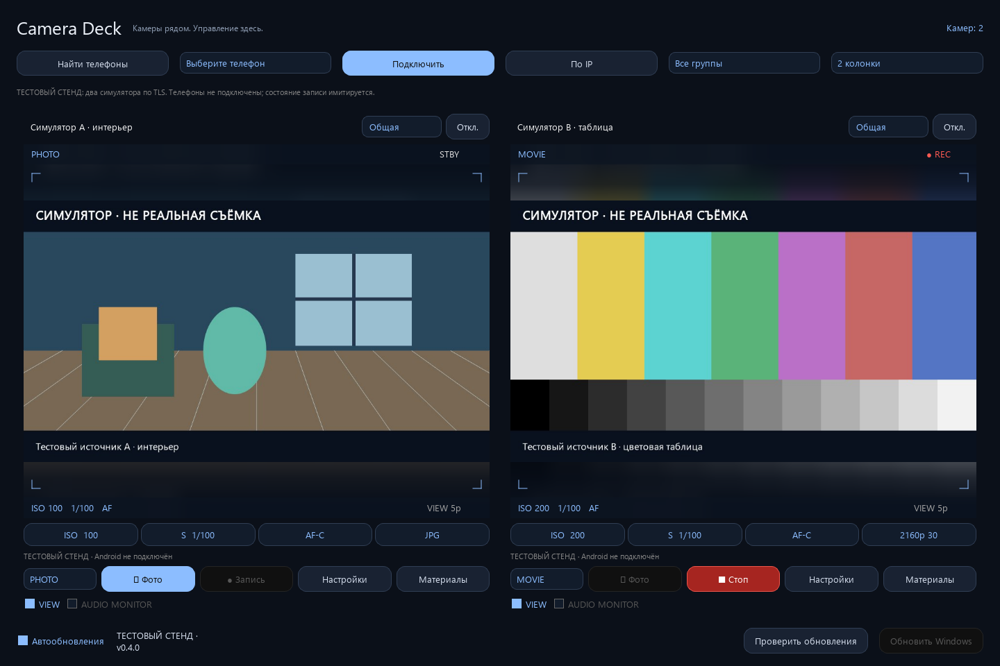
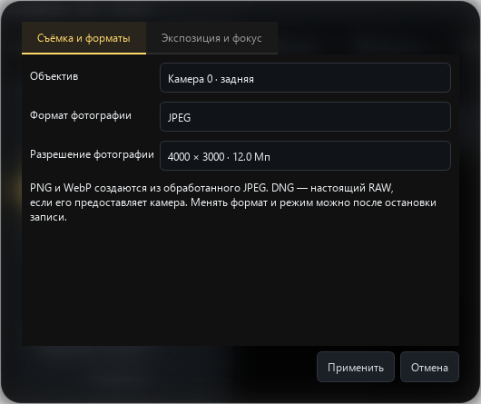
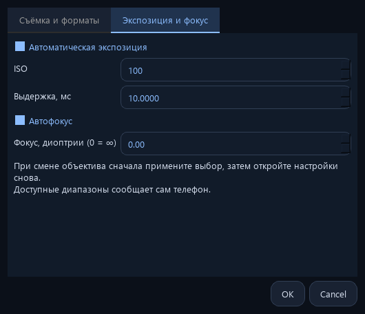

# Camera Deck

Android cameras controlled from a Windows desk. Public source, signed APK/EXE releases and anonymous updates: [prostoodin1/Camera-Deck](https://github.com/prostoodin1/Camera-Deck).

Version **0.5.0 is an experimental prerelease** for Android 9+ phones of any brand with Camera2. No manufacturer allowlist is used. Real phones have not been connected to the development machine during validation. An APK build or passing desktop tests does not demonstrate real camera compatibility, latency or long-session reliability.

Both native apps use a minimal midnight-blue interface, rounded controls and soft photographic backdrops around the Windows viewfinder. Android dialogs use system blur on Android 12+ when cross-window blur is enabled, with opaque panels otherwise. Phone preview is enabled by default; the PIN is visible on the main screen and available lenses are one tap away. No Sony branding or assets are used.

## Screenshots: functional test stand

Actual desktop screenshots connected through pinned TLS to two local **camera simulators**. They demonstrate JPEG transfer, photo download and simulated recording controls, not Android capture, real MP4 recording, audio or battery performance. Both feeds and the window are visibly labelled as a test stand.

Reproduce with `python scripts/capture_demo.py`. The development simulator listens only on loopback and is not part of the installed app.

## First connection

CI also builds **Camera Deck Preview** (`-PcameraDeckPreview=true`) with a separate `.preview` package and provider authority. It installs alongside the released app, keeps its own recordings, and does not accept release APK updates. Stop the camera in the original app before starting Preview: they share the camera and LAN ports. Do not uninstall the original app or expect its recordings to appear in Preview. A signed in-place release update still requires the original APK and updater signing identities.

1. Install `CameraDeck-Android-0.5.0.apk` on each phone. Open it, press **Включить** and grant camera and microphone access. Open **Подключить** for the name, PIN, IP and fingerprint. Notifications provide a Stop action. After upgrading, stop/start the camera in the visible app to grant the new microphone permission. The on-phone preview starts automatically after permission is granted; **Показывать камеру** pauses it when desired. **Объектив** selects cameras exposed by Android, including front-facing and external cameras.
2. Run `CameraDeck-Windows-0.5.0.exe` on Windows 10/11 x64. No Python installation is needed. Connect the computer and phones to the same trusted Wi-Fi/LAN. Update both applications for the new controls.
3. Press **Найти телефоны**, select a device and **Подключить**. If discovery fails, enter the IPv4 address displayed by the phone using **По IP**. Guest Wi-Fi/client isolation and Windows Firewall can block discovery; use a Private network and allow Camera Deck only on that network. Do not expose the ports to the Internet.
4. Compare the **entire SHA-256 TLS fingerprint** shown by both apps, tick the match confirmation and enter the phone's four-digit PIN in the same dialog. The comparison is required for first pairing, including manual IP connections.
5. Repeat for the second phone. Give each tile a group name and use the group selector / column selector to arrange the desk.

## Implemented in this preview

- Camera2 capture with runtime camera capability/range reporting and supported-mode autofocus fallback for fixed-focus and limited cameras. Only camera IDs exposed by Android are selectable; access to every physical lens or vendor camera feature is not promised.
- JPEG preview around 640 pixels wide, **up to 5fps in the default Eco mode**, or up to 10fps with Eco disabled on the phone, using latest-frame delivery. This is the initial diagnostic transport, not a finished low-latency H.264/WebRTC stream. Measured latency is not yet available.
- Explicit **Фото / Видео** selector per camera. Stop recording before switching mode, resolution, FPS or photo format.
- Recording sizes up to 3840×2160 and normal-session target rates up to 60fps, filtered by Camera2 size/minimum-frame-duration, AE ranges and H.264 encoder support. FPS options depend on the selected size. High-speed/120fps sessions are not implemented. Automatic exposure may vary below a selected range ceiling; actual output and simultaneous-stream combinations require phone validation.
- MP4 uses surface H.264 plus optional AAC-LC audio at 48kHz mono / 128kbps, enabled by default. Video bitrate scales between 2 and 60Mbps. Incomplete recordings retain `.partial` and are not listed as finished originals. Rotation is fixed during recording.
- JPEG, PNG, WebP and capability-gated RAW DNG, with selectable sizes up to 24 megapixels to limit memory use. PNG/WebP are converted from the processed JPEG: PNG does not restore lost JPEG information; WebP uses quality 95. DNG uses an actual RAW_SENSOR image and matching capture metadata. A failed RAW+preview combination reports an error and restores JPEG.
- ISO + shutter applied together in manual mode, or automatic exposure; focus in dioptres or continuous autofocus. Controls report actual sensor exposure values. Unavailable capabilities are disabled or rejected by the phone.
- Photos are unavailable while recording. Stop video before changing the camera or installing an update. Recording remains on the phone if the Windows desk disconnects; use the phone notification's Stop action to stop the service if needed.
- **Материалы** lists up to 100 latest completed files and downloads selected originals to a chosen Windows folder. Recordings live in the app-specific external captures directory. **Uninstalling the Android app removes its recordings**; download originals first. Interrupted desktop transfers are not presented as complete files.

## Public signed updates

Windows anonymously checks `prostoodin1/Camera-Deck` releases on launch and hourly when automatic checks are enabled. Only `camera-deck-v*` releases with a valid `camera-deck-update.json` signature are accepted, including prereleases. The highest signed version code wins; this does not depend on GitHub's `latest` release.

No GitHub account, Git installation or token is required for installed apps to check/download updates. Update keys and APK identity remain continuous with earlier builds. Publishing releases is a separate maintainer action requiring GitHub authentication.

Versions through 0.3.0 checked the previous development repository. Download/install 0.3.1 or newer from this public repository once to switch channels; subsequent updates use this public repository automatically. Install the APK over the existing app rather than uninstalling it, to keep recordings.

- Windows downloads a newer EXE automatically, verifies its signed metadata, size and SHA-256, and offers **Обновить Windows**. Confirming an idle restart replaces the EXE and keeps `<exe>.previous` for recovery. Current recordings or unknown camera states block installation. The initial EXE has no Windows Authenticode publisher certificate and may trigger SmartScreen.
- For Android, press **Обновить Android** on its connected tile. Windows obtains the APK, checks the signed manifest and hash and transfers it over the paired TLS channel. Android independently verifies the RSA signature, hash, package ID, version code and existing APK signing certificate. On the phone open **Ещё → Установить обновление**, permit this app as an installation source if needed and confirm Android's installer. Silent installation is not claimed.
- Ordinary APK updates keep data; **never uninstall to update**. A complete real-device update from version N to N+1 has not yet been exercised.

No shared GitHub credential is embedded in either app. Android updates are fetched by Windows from public releases and passed to the phone. Camera control itself does not need Internet access.

## Sound and capture controls

Select **Видео**, open **Настройки**, choose recording size/FPS and leave **Записывать звук в MP4 (AAC)** enabled. Missing microphone permission produces an error rather than a silent recording. Explicitly disable this checkbox for silent video. Select **Фото** to enable its shutter button and choose photo format/size in the same settings dialog. RAW dimensions may differ from processed-photo dimensions.

Check **Слушать микрофон телефона** to hear live sound on Windows; this controls listening separately from the recording sound track. One AudioRecord feeds both AAC recording and live monitoring. Monitoring is opt-in, uses pinned/authenticated TLS and raw 48kHz mono signed 16-bit little-endian PCM, and has bounded queues that discard stale backlog. At most two listeners are allowed per phone. Session expiry/revocation ends monitoring. Headphones avoid speaker-to-phone feedback. A missing/unsupported Windows output device is reported; this version needs 48kHz mono Int16 output support.

Hiding/minimizing/pausing a camera's preview stops live monitoring but does not stop an active MP4 sound track. With no listener or recording, the microphone stops. The notification indicates microphone activity.

**Resolution/FPS selectors control the original recording.** Live images remain about 640px at 5fps Eco / 10fps normal. Live PCM and JPEG use separate paths and are not lip-synchronized. MP4 uses a common elapsed-realtime origin and hardware audio timestamps when available; an unknown Camera2 timebase uses first-frame calibration. No measured synchronization accuracy is claimed.

## Background operation and battery

Start the camera while the Android application is visible, then press **Продолжить в фоне**, switch applications or turn off the screen. The existing camera foreground service continues with a visible notification and Stop action. This does not start the camera after a reboot or force-stop, and Android may terminate it under system pressure.

Eco is enabled by default and saved between launches. It reduces JPEG encoding quality from 72 to 60 and caps preview encoding and Windows frame requests at 5fps, without changing recording targets. The sensor FPS range comes from the device; a 5fps sensor mode is not assumed. Recording keeps the selected target FPS. Microphone capture, PCM transmission and AAC encoding also consume battery when enabled.

Local preview on the phone is on by default while the activity is visible and can be paused with **Показывать камеру**. It uses the current JPEG transport (5fps Eco / 10fps normal), rather than a full-rate native viewfinder. The screen is never kept awake automatically. Minimizing the Windows desk, hiding a camera by group or unchecking **Предпросмотр** stops its frame requests; status checks slow to once every three seconds. Other visible desks may still request preview. Stopping preview never stops an active recording.

Within four seconds of the last remote frame request (plus up to one second for the policy timer), when there is no local preview, pending operation or recording, the app stops Camera2 repeating requests and JPEG work. It retains the open camera/session for resumption inside the already-started foreground service; it does not claim to fully power down every manufacturer's camera hardware. A new preview request or capture command resumes work. During recording with no viewer the repeating request targets only the hardware recorder surface; it does not produce preview images.

The CPU wake lock has a 90-second safety timeout and is renewed only for preview, recording, microphone listeners, camera transitions or file/update transfer. It is released in standby when sound is unused. There is no automatic battery-optimization exemption, permanent polling wakeup or Wi-Fi lock. Deep Doze / manufacturer power saving may delay networking; instant wake and negligible drain are not promised. See [foreground service rules](https://developer.android.com/develop/background-work/services/fgs/service-types) and [Doze networking restrictions](https://developer.android.com/training/monitoring-device-state/doze-standby).

Battery drain, thermal behaviour and uninterrupted screen-off recording still require measurements on real phones from different manufacturers. Compare Eco and normal mode under the same Wi-Fi, scene, brightness and recording workload before quoting a percentage-per-hour saving.

## Connection recovery

The reported TLS EOF was reproduced on an Android 15 emulator: Conscrypt signs an already hashed TLS transcript using `NONEwithECDSA`, but the old keystore key did not authorize `DIGEST_NONE`. Android creates a new `camera-deck-tls-v2` key with that authorization and uses the platform KeyManagerFactory. The old key is retained; the TLS fingerprint changes once, so compare the new full fingerprint on both screens when pairing. APK/update signing identities are separate and unaffected. Windows closes failed handshake sockets and explains recovery steps. Certificate pinning remains mandatory before credentials are sent. Physical-phone verification remains required.

## Protocol and security

UDP `39811` handles discovery; TLS `39812` carries commands, frames and original files. Each Android installation creates its own EC certificate/private key in AndroidKeyStore. The Windows client checks the exact certificate fingerprint **before sending credentials**. Discovery is untrusted and never grants access by itself.

The displayed PIN expires after five minutes and rotates after pairing. Pairing attempts are globally limited to five per minute. Random 256-bit session tokens expire after eight hours and remain in memory. **Отключить все компьютеры** revokes them. A new pairing is required after either app restarts. Revocation blocks new requests; an already-started file transfer may finish.

This version is for a trusted local network. It has no Internet relay, remote screen control, frame-accurate camera synchronisation, HDR/Log, 4K guarantee or automatic recovery of a disconnected camera device.

## Build and validation

Desktop: Python 3.13 x64, `pip install -r desktop/requirements.txt`, plus `pytest` and `pyinstaller` for development/build. Run `python desktop/main.py`. Before packaging run `python scripts/collect_licenses.py`, then inside `desktop/` run `python -m PyInstaller --noconfirm --onefile --windowed --name CameraDeck --add-data "update-public.pem;." --add-data "../third_party_licenses;third_party_licenses" --add-data "../THIRD_PARTY_NOTICES.md;." main.py`.

Android: JDK 17, Gradle 8.7, Android SDK platform 35 and build-tools 35.0.0. Set `JAVA_HOME`, `ANDROID_HOME` and `CAMERA_DECK_GRADLE` (absolute path to `gradle.bat`). From this folder run `python scripts/signing.py`, then `python scripts/build_android.py`. The build also runs Android Lint.

`scripts/signing.py` creates the persistent APK keystore and a separate RSA update signing key under `%LOCALAPPDATA%/CameraDeck/signing`, restricting its ACL to the current Windows user and SYSTEM. Its password is protected with DPAPI. Public keys are generated into both apps. **Keep these private identities for all future releases; losing/replacing them breaks update continuity.** They are not committed or uploaded. Back up the signing identity securely; DPAPI ciphertext alone is not portable to another Windows account.

`python -m pytest tests -q` checks update signatures, tampering, rollback rejection, unsafe metadata, TLS pin-before-credentials, redirect credentials, DPAPI, bounded PCM queues, unknown audio rejection, capture controls, preview suspension and pure-Java power transitions (requires JDK). Android JVM tests validate mode/rate/format combinations with fixture capabilities. None exercises actual microphones, speakers, codecs, RAW hardware or a real phone. After building, `python scripts/package_release.py` creates APK, EXE, signed update envelope and checksums under `release/<version>/`; the source ZIP comes from the tracked Git tree.

Before calling this ready for daily shooting, verify each target phone's lenses/manual controls, orientation, photo output, MP4 playback, preview latency, two-camera bandwidth, Wi-Fi interruptions, foreground/background/screen-off operation, heating and an actual signed N→N+1 update. No such hardware results are claimed by this prerelease.

## License

GPL-3.0-only; see [LICENSE](LICENSE) and [third-party notices](THIRD_PARTY_NOTICES.md). Windows uses the GPL distribution of PyQt6.
