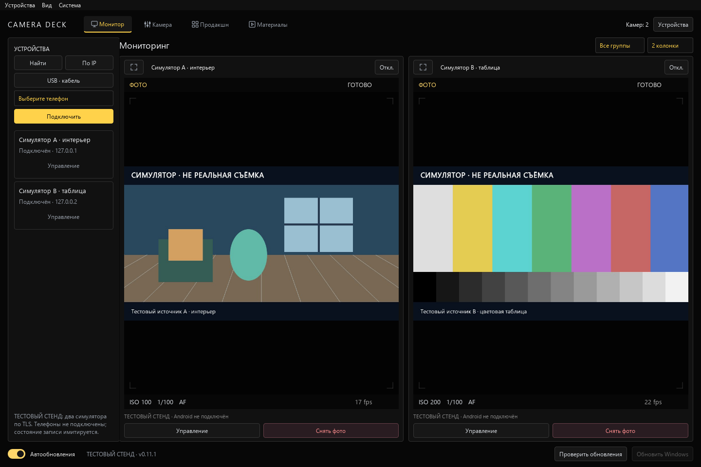
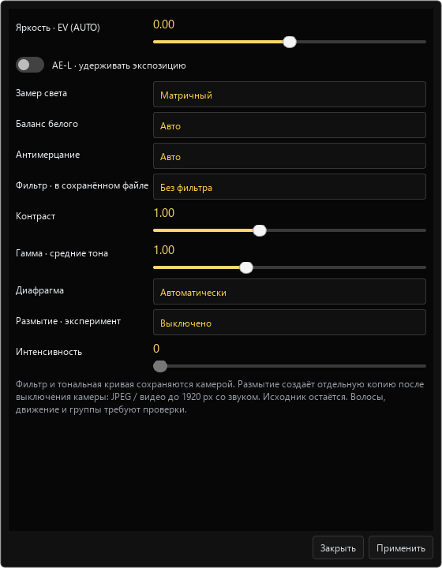
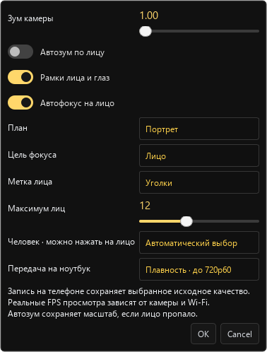

# Тестовый стенд Client

Скриншоты созданы scripts/capture_demo.py: два локальных TLS-симулятора, синтетическое изображение и имитируемое состояние записи. Это настоящий интерфейс Windows, но не проверка камеры, звука, размытия или Android-устройства.

